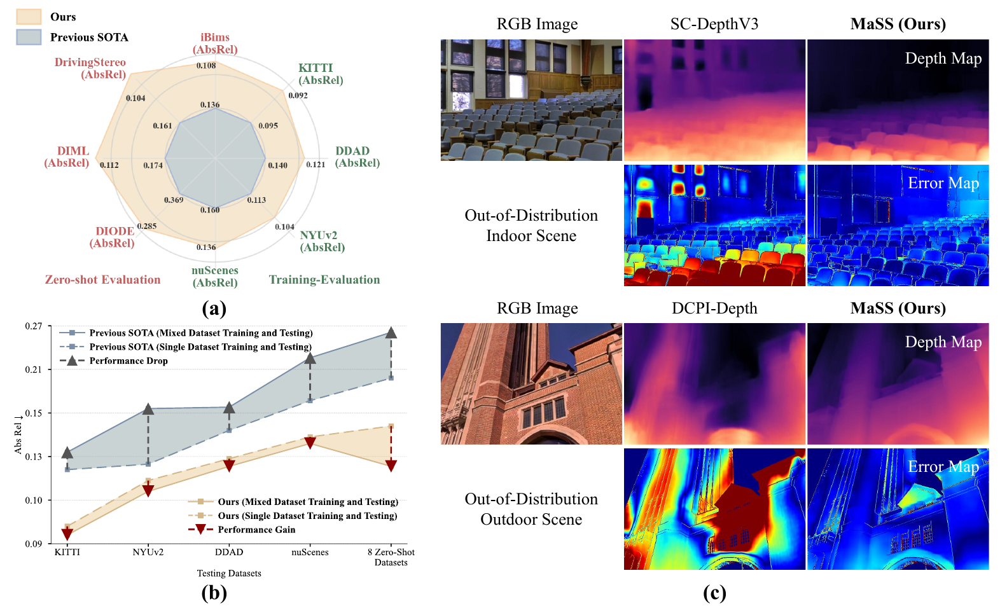
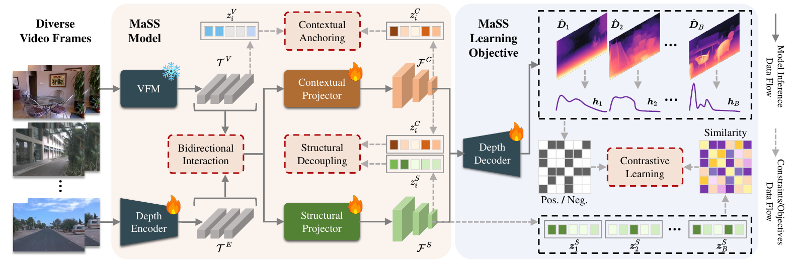
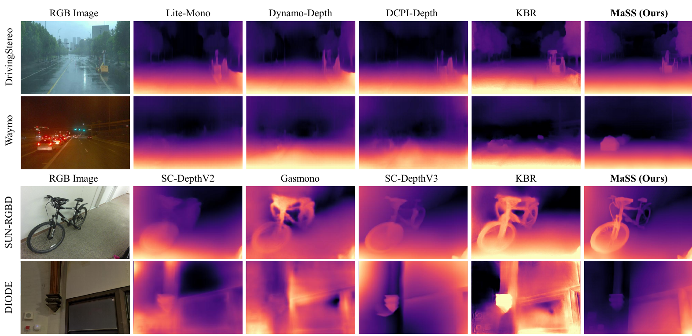

<div align="center">

<h1>MaSS</h1>
<!-- <h3>Learning to Discriminate Scene Structures Makes<br>Self-Supervised Depth Learning Scalable</h3> -->
<p><a href="https://scholar.google.cz/citations?user=uanS4aIAAAAJ&amp;hl=zh-CN&amp;oi=sra">Mengtan Zhang</a> · Yuchuan Cui · Yu Ma · Zizhan Guo · Wei Ye · <a href="https://scholar.google.cz/citations?user=P5AJTXcAAAAJ&amp;hl=zh-CN&amp;oi=sra">Rui Fan</a><sup>✉</sup></p>
<p>Tongji University<br><sup>✉</sup> Corresponding author</p>
<p>
<!-- Add the arXiv URL around this badge when the paper is available. -->

<a href="https://mias.group/MaSS/"></a>
<a href="https://huggingface.co/mengtanZ/MaSS/"></a>
</p>
<!-- <p><strong><a href="#results">Results</a> · <a href="#setup">Setup</a> · <a href="#training">Training</a> · <a href="#evaluation">Evaluation</a></strong></p> -->

</div>

**MaSS makes self-supervised monocular depth learning scalable to diverse scenes.** It separates contextual and structural representations, helping a single depth model learn across indoor and outdoor environments, dynamic scenes, adverse weather, and beyond.



*MaSS benefits from diverse training data and generalizes to unseen scene structures. Figure 1 from the paper.*

## 🌟 Highlights

- **Learn scene structure.** Dedicated contextual and structural pathways separate spatial layout from semantic context.
- **Adapt a frozen visual backbone.** Bidirectional interaction brings trainable geometric features into a pretrained DINOv2 ViT-B/14 backbone.
- **Train one model across domains.** A unified recipe mixes DDAD, NYUv2, KITTI and nuScenes; four individual-dataset recipes are also provided.
- **Evaluate beyond the training domains.** The paper studies zero-shot transfer on eight additional benchmarks spanning driving, indoor and out-of-distribution scenes.

## Method



*The MaSS framework combines a frozen visual foundation model with trainable geometric features, decouples contextual and structural representations, and fuses them for depth prediction. Figure 3 from the paper.*

<a id="results"></a>

## 💾 Results and Pretrained Models

The following numbers are **reported in the paper**, using per-image median scaling. Each cell shows **Abs Rel ↓ / δ₁ ↑**.

### Training-domain evaluation

| Training setting | KITTI | DDAD | NYUv2 | nuScenes |
| --- | ---: | ---: | ---: | ---: |
| MaSS, individual datasets | 0.094 / 0.909 | 0.128 / 0.845 | 0.109 / 0.868 | 0.139 / 0.851 |
| **[MaSS, mixed datasets](https://huggingface.co/mengtanZ/MaSS/)** | **0.092 / 0.913** | **0.125 / 0.862** | **0.104 / 0.890** | **0.134 / 0.852** |


### Zero-shot generalization

| Evaluation dataset | MaSS, single-source training | MaSS, mixed training |
| --- | ---: | ---: |
| Waymo | 0.141 / 0.836 | **0.123 / 0.867** |
| DrivingStereo | 0.131 / 0.850 | **0.100 / 0.905** |
| Cityscapes | 0.132 / 0.846 | **0.103 / 0.896** |
| DIML | 0.115 / 0.875 | **0.104 / 0.890** |
| iBims-1 | 0.113 / 0.869 | **0.107 / 0.883** |
| SUN-RGBD | 0.139 / 0.865 | **0.127 / 0.893** |
| 7-Scenes | 0.144 / 0.792 | **0.120 / 0.861** |
| DIODE | 0.312 / 0.711 | **0.289 / 0.736** |




*Zero-shot depth predictions across driving, indoor and out-of-distribution scenes. Figure 4 from the paper; the rightmost column is MaSS.*

<a id="setup"></a>

## 🛠️ Setup

The reference configuration is **Python 3.9, PyTorch 2.0.1, CUDA 11.7 and xFormers 0.0.20**. Use a CUDA-capable GPU for training and full-resolution evaluation.

```bash
git clone https://github.com/mengtanZ/MaSS.git
cd MaSS

conda create -n mass python=3.9.25 -y
conda activate mass
python -m pip install -r requirements.txt
```

The root `requirements.txt` installs the GPU stack from [`mass/requirements/cu117.txt`](mass/requirements/cu117.txt) and the dependencies from [`mass/requirements/base.txt`](mass/requirements/base.txt). A fully pinned dependency snapshot is available at [`mass/requirements/lock-cu117.txt`](mass/requirements/lock-cu117.txt).

Run the following commands from the repository root with the `mass` environment activated. The shell scripts invoke the Python package using `python -m mass.train` and `python -m mass.evaluate_depth_submit` (or `python -m mass.evaluate_city` for Cityscapes).

### Repository layout

```text
MaSS/
├── assets/               # paper figures used in this README
├── mass/
│   ├── datasets/         # data loaders
│   ├── dinoV2/           # DINOv2 backbone and adapters
│   ├── networks/         # depth, pose and contrastive components
│   ├── splits/           # training and evaluation file lists
│   ├── utils/
│   ├── docs/             # data and checkpoint guides
│   ├── licenses/         # third-party licenses and notices
│   ├── requirements/     # dependency lists and pinned snapshot
│   ├── weights/          # downloaded checkpoints (ignored by Git)
│   ├── train.py
│   ├── trainer.py
│   └── evaluation.py     # shared evaluation protocols
├── scripts/
│   ├── training_submit.sh
│   └── testing_submit.sh
├── LICENSE
├── README.md
├── environment.yml
└── requirements.txt
```

### 1. Prepare data

Place the prepared datasets under `data/`, or create local symlinks to their existing locations. The scripts use `DATA_ROOT=data` by default; edit their path variables or set `DATA_ROOT` when using another location.

```text
data/
├── ddad/                 # training/ and testing/
├── nyu/                  # training/ and testing/
├── kitti/                # preprocessed training/ and testing/depth/
├── nuscenes/             # training/ and testing/
└── kitti_raw/            # raw KITTI PNG images for evaluation
```

Training requires temporal RGB frames, camera intrinsics and prepared pseudo-depth maps under `psedo_depth/`. See [the data preparation guide](mass/docs/DATASETS.md) for the required layouts, encodings and evaluation ground truth. Local datasets, downloaded weights and run outputs are ignored by Git.

The preprocessed [**[KITTI]**](https://github.com/JiawangBian/sc_depth_pl) and [**[DDAD]**](https://github.com/JiawangBian/sc_depth_pl) datasets are provided by the project [SC-DepthV3](https://github.com/JiawangBian/sc_depth_pl). <br>
For the [**[nuScenes]**](https://www.nuscenes.org/) dataset, you can download the original data from their official websites, preprocess them by following the instructions from the [Dynamo-Depth](https://github.com/YihongSun/Dynamo-Depth) project, and organize them into the above format. <br>

### 2. Prepare weights

**For training**, download the official [DINOv2 ViT-B/14 checkpoint with four registers](https://dl.fbaipublicfiles.com/dinov2/dinov2_vitb14/dinov2_vitb14_reg4_pretrain.pth) and save it as:

```text
mass/weights/dinov2_vitb14_reg4_pretrain.pth
```

**For evaluation**, download `encoder.pth` and `depth.pth` from [the MaSS mixed-dataset checkpoint on Hugging Face](https://huggingface.co/mengtanZ/MaSS/tree/main/mass_mix) and place both files in `mass/weights/mass_mix/`. A complete encoder checkpoint already contains the frozen DINOv2 backbone.

See [the weight guide](mass/docs/WEIGHTS.md) for download commands, initialization and checkpoint contents.

## Training

From the repository root, run:

```bash
bash scripts/training_submit.sh
```

The default command trains **one mixed model on DDAD + NYUv2 + KITTI + nuScenes** at 384×640 with batch size 6. The four single-dataset commands are directly below it in the same script and are commented out. To select one, comment out the mixed command and enable that dataset's `DATA_PATH` assignment and Python command.

Training checkpoints are saved under `tmp/<model_name>/models/`. The default mixed run uses 10 epochs; its final checkpoint is `tmp/mass_mix/models/weights_9/` because epoch indices start at zero.

## Evaluation

With the trained mixed checkpoint prepared under `mass/weights/mass_mix/`, run:

```bash
bash scripts/testing_submit.sh
```

**NYUv2 and KITTI are enabled by default.** The commands for DDAD, nuScenes, Waymo, DrivingStereo, Cityscapes, DIML, iBims-1, SUN-RGBD, 7-Scenes and DIODE are commented out in the same script. To enable a dataset, uncomment its path assignments and Python command.

To evaluate the checkpoint produced by your own training run:

```bash
WEIGHTS=tmp/mass_mix/models/weights_9 bash scripts/testing_submit.sh
```

Each evaluation writes one row of metrics to `eval/<dataset>.csv`: **Abs Rel, Sq Rel, RMSE, RMSE log, δ₁, δ₂ and δ₃**, together with the checkpoint path, image count and input resolution. Evaluation uses the input size stored in the checkpoint unless explicitly overridden, and applies per-image median scaling by default. Dataset layouts and crop conventions are documented in [the data preparation guide](mass/docs/DATASETS.md).

## Citation

If MaSS is useful for your research, please cite the manuscript:

```bibtex
@misc{zhang2026mass,
  title  = {Learning to Discriminate Scene Structures Makes Self-Supervised Depth Learning Scalable},
  author = {Zhang, Mengtan and Cui, Yuchuan and Ma, Yu and Guo, Zizhan and Ye, Wei and Fan, Rui},
  booktitle = {Advances in Neural Information Processing Systems},
  year   = {2026}
}
```

## 📧 Contact

If you have any questions, feel free to contact us via issue or [email](mailto:zmt200110@tongji.edu.cn).

## Acknowledgements

We thank the authors of [DINOv2](https://github.com/facebookresearch/dinov2), [Lite-Mono](https://github.com/noahzn/Lite-Mono), [Monodepth2](https://github.com/nianticlabs/monodepth2), [SC-DepthV3](https://github.com/JiawangBian/sc_depth_pl) and [Depth Anything V2](https://github.com/DepthAnything/Depth-Anything-V2) for their open research resources.

## License

MaSS contributions are released under the [MIT license](LICENSE). Third-party components retain their original terms, including DINOv2's Apache 2.0 license and the non-commercial terms of inherited Monodepth2 components. See [the third-party notices](mass/licenses/THIRD_PARTY_NOTICES.md) for details. Dataset and checkpoint licenses are separate from the source-code license.
